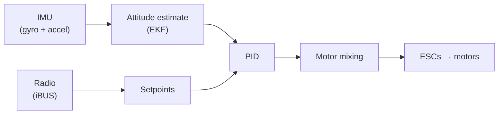

# Drone Attitude Estimation

A quadcopter flight controller I built from scratch: embedded C on an STM32 microcontroller, a hand-wired perfboard, and the full pipeline from raw IMU readings to stable flight.

**Status:** flying. This is an ongoing project. I'm now using the drone as a testbed to compare attitude estimation filters ([next steps](#next-steps)).

<!-- TODO: hero GIF of the drone hovering. Save it as media/hover.gif, then uncomment:
<p align="center">
  
</p>
-->

<!-- TODO: link to a full flight video:
▶️ [Watch a full flight](https://youtu.be/...)
-->

## Credit

I learned this by following the **[QuadFS: Quadcopter From Scratch](https://github.com/huobuilds/quadfs_flight_controller)** course by Huobuilds ([YouTube series](https://www.youtube.com/playlist?list=PLBTVuKQ1XcVpDQbM3uqsKZsAigoQidbD6)). The course provided the architecture and reference firmware. I built and wired the hardware, worked through each stage of the firmware, and restructured the code into separate hardware, algorithm and application layers. Files that started from the course keep their original copyright headers, and this repository is licensed under GPL-3.0, the same as the original.

## What it does

| | |
|---|---|
| **Microcontroller** | STM32F411CEU6 (WeAct Black Pill), ARM Cortex-M4F at 72 MHz |
| **IMU** | MPU6050 / MPU6500 / MPU9250 over I²C at 400 kHz |
| **Attitude estimation** | Quaternion-based error-state EKF (gyro + accelerometer), following Kok, Hol & Schön |
| **Control** | PID on roll and pitch angle, yaw-rate control, 333 Hz control loop |
| **Radio** | FlySky receiver, iBUS protocol over UART with DMA |
| **Motors** | 4 ESCs driven with 400 Hz PWM |
| **RTOS** | FreeRTOS |
| **Telemetry** | Roll, pitch and motor outputs over USB serial at 100 Hz, plotted live by `tools/monitor.py` |

<!-- TODO: photos of the build. Save them in media/, then uncomment:
<p align="center">
  
  
</p>
-->

## How it works

Every 3 ms, one FreeRTOS task runs the full pipeline:



1. **Read the radio.** Parse the latest iBUS frame from the receiver.
2. **Read the IMU.** Remove the gyro bias (calibrated at every power-up), apply the accelerometer calibration, and median-filter the gyro rates.
3. **Estimate attitude.** The EKF predicts the orientation quaternion from the gyro, then corrects tilt drift using the accelerometer's gravity direction. Accelerometer readings far from 1 g (vibration or hard maneuvers) are ignored.
4. **Arm/disarm.** A switch on the transmitter arms and disarms the motors.
5. **Control.** Stick positions become target angles, the PID computes correction torques (with anti-windup), and a mixer converts throttle plus torques into a thrust per motor, then into PWM.

A lower-priority task streams telemetry, and another drives the status LED (blinking when disarmed, solid when armed).

## Repository layout

```
firmware/                 STM32CubeIDE project
  Core/Src/Hardware/      I²C, IMU driver, radio, motor PWM, board wrappers (the only code that touches the HAL)
  Core/Src/Algorithms/    Estimators, PID, motor mixing, setpoints (pure C math)
  Core/Src/App/           Control loop and arming, telemetry, status LED, startup
  Drivers/, Middlewares/  ST HAL, CMSIS-DSP, FreeRTOS, USB device library (vendor code)
tools/monitor.py          Live plot of roll, pitch and motor outputs over USB serial
```

Keeping the math free of hardware calls means the estimators can also be compiled and run on a PC, which the filter comparison below relies on.

## Hardware

| Function | Pin | Peripheral |
|---|---|---|
| IMU SCL / SDA | PB8 / PB9 | I2C1, 400 kHz |
| Radio RX (iBUS) | PA10 | USART1 RX + DMA |
| Motor 1 / 2 | PA1 / PA0 | TIM2 CH2 / CH1 |
| Motor 3 / 4 | PA9 / PA8 | TIM1 CH2 / CH1 |
| Status LED | PA5 | GPIO |
| Telemetry | USB-C | USB CDC (virtual COM port) |

<!-- TODO: wiring diagram or perfboard photo, and a link to the bill of materials, e.g. hardware/BOM.md -->

## Building and flashing

**Toolchain:** STM32CubeIDE with **GNU Tools for STM32 10.3-2021.10** (`arm-none-eabi-gcc` 10.3.1), targeting the Cortex-M4 with hardware floating point (`-mfpu=fpv4-sp-d16 -mfloat-abi=hard`) and newlib-nano. Matrix math uses the prebuilt CMSIS-DSP library (`libarm_cortexM4lf_math.a`, included). The project has also been checked to compile with `arm-none-eabi-gcc` 13.2.

1. **Import:** in STM32CubeIDE, choose **File → Import → General → Existing Projects into Workspace** and select the `firmware/` folder.
2. **Select the toolchain:** in **Window → Preferences → STM32Cube → Toolchain Manager**, install GNU Tools for STM32 10.3-2021.10, then select it under **Project → Properties → C/C++ Build → Settings**.
3. **Build:** press `Ctrl+B` (Debug configuration).
4. **Flash:** connect an ST-Link to the Black Pill's SWD pins (SWDIO, SWCLK, GND, 3.3V) and click **Debug** or **Run**.

**Live telemetry:**

```bash
pip install pyserial matplotlib numpy
python3 tools/monitor.py /dev/tty.usbmodemXXXX   # or COM3 on Windows
```

> **Safety:** test with the propellers off whenever you change firmware. ESC calibration (`esc_calibrate_all()` in `main.c`) is disabled by default because it sends full throttle. Enable it only once, with the props off, then disable it again.

## Next steps

The drone flies, so I'm now using it to compare attitude estimators on real hardware:

- **Add a fourth filter.** Implement a Mahony filter (a nonlinear complementary filter on rotations) from the original paper, alongside the complementary filter and the EKF.
- **Build a ground-truth rig.** A single-axis test stand with a magnetic encoder (AS5600) gives the true tilt angle to compare against.
- **Log raw data and replay it.** Record raw IMU and encoder data, then run every filter offline on the same recordings so the comparison is fair.
- **Report the results.** Compare accuracy (RMSE), drift, response to motor vibration and CPU time per update on the STM32, and write up the findings here.

## License

GPL-3.0. See [LICENSE](LICENSE). Based on [QuadFS](https://github.com/huobuilds/quadfs_flight_controller) by Huobuilds.
